# Pure Insights Command Center

**Platform operational analytics for the custom analytics portal** — Case Study 3.

After the move from Tableau Server to a custom React / Node.js / Snowflake / AWS portal, the business lost native
admin visibility. The Command Center restores it:

* **Report health.** Load latency, refresh failures and ownership for every report.
* **Real-time alerts.** A WebSocket channel notifies operators when a dashboard load exceeds 15 s or an automated refresh fails.
* **Cost attribution.** Snowflake credits are attributed to individual reports from `ACCOUNT_USAGE` logs and turned into a unit cost per active user view.

**Stack:** CSV → **PostgreSQL 16** → **Node.js / Express 5** → **React 19**. A Python pipeline handles the data layer.

| Task / deliverable | Where |
|---|---|
| **Task 1**: full-stack dashboard with RBAC (system health, orphaned reports) | [`server/`](server) · [`client/`](client) · [docs/RBAC.md](docs/RBAC.md) |
| **Task 2**: real-time WebSocket alerting (> 15 s latency, failed refreshes) | [`server/src/services/`](server/src/services) · [docs/API_SPEC.md §5–6](docs/API_SPEC.md#5-alerting-rules-task-2) |
| **Task 3**: Snowflake `ACCOUNT_USAGE` cost attribution, unit cost per active view | [`sql/snowflake/`](sql/snowflake/README.md) · [docs/COST_ALLOCATION_METHODOLOGY.md](docs/COST_ALLOCATION_METHODOLOGY.md) |
| **Deliverable 1**: runnable full-stack codebase | this repository ([Quick start](#quick-start)) |
| **Deliverable 2**: REST API & WebSocket technical specification | [docs/API_SPEC.md](docs/API_SPEC.md) · [openapi.yaml](docs/openapi.yaml) · [asyncapi.yaml](docs/asyncapi.yaml) |
| **Deliverable 3**: Snowflake cost allocation SQL script suite | [`sql/snowflake/00–09`](sql/snowflake/README.md) |
| Injected data anomalies, identified, cleaned and documented | [`pipeline/pic_pipeline/quality_rules.py`](pipeline/pic_pipeline/quality_rules.py) · [docs/DATA_QUALITY.md](docs/DATA_QUALITY.md) (generated) |
| Business synthesis | [docs/BUSINESS_FINDINGS.md](docs/BUSINESS_FINDINGS.md) (generated from live queries) |
| Architecture | [docs/ARCHITECTURE.md](docs/ARCHITECTURE.md) |

---

## Quick start

**Prerequisites:** Docker (Desktop running), Node.js ≥ 20, Python ≥ 3.11.

```bash
cp .env.example .env          # local defaults; change JWT_SECRET for anything beyond local use
npm install
npm run setup                 # Postgres (docker compose) → Python venv → pipeline → demo users
npm run dev                   # API on :4000, dashboard on http://localhost:5173
```

Sign in with any demo account. The password is `SEED_DEMO_PASSWORD` from `.env` (default `PureInsights!2026`).

| Account | Role | Sees |
|---|---|---|
| `admin@pureinsights.local` | Administrator | everything, plus owner reassignment, accounts and the audit log |
| `sre@pureinsights.local` | Platform Engineer | health, alerts (ack/resolve), reports, orphans, data quality, replay control |
| `finops@pureinsights.local` | FinOps Analyst | cost allocation, chargeback, data quality, read-only health and alerts |
| `user_7@company.com` | Report Owner | only the 7 reports user_7 currently owns, and their alerts |

**To see the real-time alerting:** sign in as `sre@…` or `admin@…`, open **Alerts**, and click **Start replay**.
The 2,000 CSV observations stream through the live ingest → alert → WebSocket path, one snapshot at a time.

| Command | What it does |
|---|---|
| `npm run setup` | Starts Postgres, creates the Python venv, runs the full pipeline, seeds users (idempotent; safe to re-run) |
| `npm run pipeline` | migrate → ingest → clean → simulate ACCOUNT_USAGE → cost SQL suite → verify → export → DQ report → findings |
| `npm run dev` | API (`node --watch`) and Vite dev server |
| `npm start` | Production build: Express serves the built React app on :4000 |
| `npm test` | pytest (40) + server `node:test` (31) + client Vitest (14) |
| `npm run verify` | Rebuilds the `cost.*` views from `sql/snowflake/01–09` and asserts all reconciliation checks pass |
| `npm run lint` | ruff + eslint (server and client) |
| `npm run screenshots` | Re-captures the README screenshots from the running app (Playwright; first run `pipeline/.venv/bin/playwright install chromium`) |

---

## What the data actually contains

All figures below come from programmatic checks: [`quality_rules.py`](pipeline/pic_pipeline/quality_rules.py)
and the tests in [`pipeline/tests/`](pipeline/tests).

* **Shape.** 2,000 rows, but only **100 distinct `report_id`s**, each appearing exactly 20 times in identical order. There is no timestamp. The rows are modelled as **100 reports × 20 monthly snapshots** (2025-01 → 2026-08). This is the one modelling assumption, and it is documented.
* **Orphaned owners: 245 rows.** `nan` × 128 and `ORPHANED_REPORT` × 117. These are nulled and flagged. **14 reports** are orphaned right now (latest snapshot). Admins can reassign owners, and every reassignment is audited.
* **Negative Snowflake credits: 24 rows**, from −13.6 to −0.8 (total −161.04). These are **quarantined**: excluded from attribution, not abs()'d and not zeroed. Clean total: **1,206,352.48** credits.
* **Load latency up to 55 s.** The alert threshold is **> 15 s**, from the brief. **55 s is the dataset's extreme, not a threshold**: 6 readings sit exactly at 55.0 s. Spikes are kept unchanged and alerted on. 7 readings of exactly 15.0 s correctly do *not* alert. 1,490 rows (74.5 %) breach.
* **Active users vs AWS cost.**
  * The correlation is **−0.027**, so hosting cost does not track usage.
  * 4 zero-view months still carry cost.
  * 93 rows report more peak concurrent users than monthly views, which is impossible.
  * 135 rows exceed the robust Q3 + 3×IQR cost-per-view fence ($2.06/view).
* **Not in the brief, but handled.**
  * `UNKNOWN` refresh status (100 rows) is treated as a telemetry gap, not a failure.
  * Ownership churns: reports average 10 different owners over 20 months.

---

## Screenshots

All screenshots come from the running application with the real dataset (`npm run screenshots`). The UI is
dark-only, set in Geist, with the **Everpure brand orange** (`#ff7023`, from everpuredata.com's
`--ps-color-brand-500` token) as the single accent and its darker step `#d55d1d` for chart marks. The layout takes
inspiration from a two-tone analytics dashboard concept: a top pill navigation, large light-weight titles and
numbers, rounded charcoal cards for tables and charts, lighter glass cards for KPIs, pill filter groups, gradient bars
with a solid cap, and a glow callout. The most severe tier is called out in red: the Critical card and critical
pop-up notifications use a red background. Severity is always shown with an icon and a label, never by colour alone.
Every page header shows the live alert counts and the WebSocket state; the **Mute notifications** button in the top
bar silences pop-ups.

### 1 · Sign in

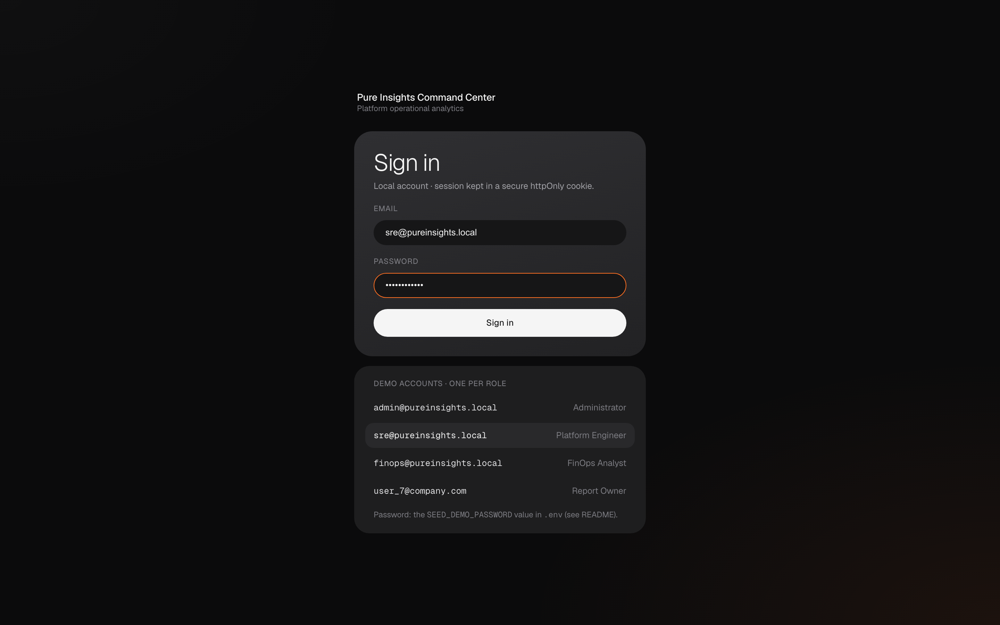

Local accounts stored in PostgreSQL with bcrypt hashes. A successful sign-in sets an httpOnly,
`SameSite=Strict` session cookie; the token never reaches JavaScript. The same cookie authenticates the
WebSocket. The list below the form has one demo account per role. Failed sign-ins are rate-limited and audited.

### 2 · System Health (Task 1)

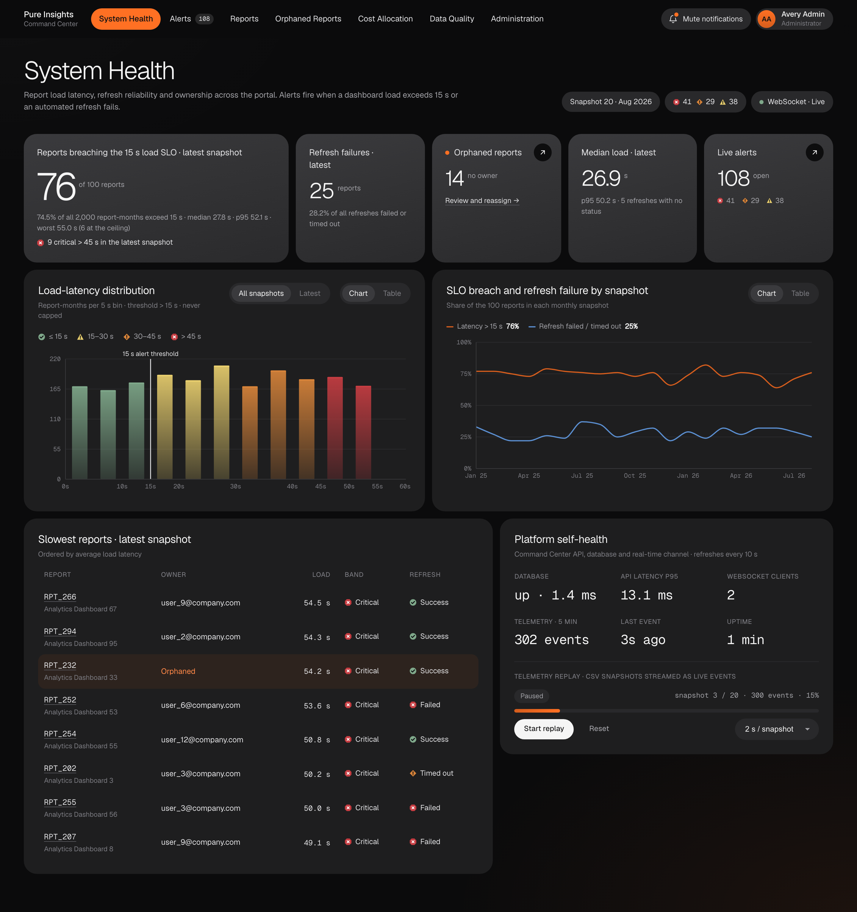

The landing page for operators.

* **Headline:** **76 of 100 reports** breach the 15 s load SLO in the latest snapshot, and 74.5 % of all 2,000 report-months do.
* **Latency histogram:** the 15 s threshold marks where the bins turn from OK to Warning. The values run evenly up to the 55 s ceiling, which shows the latency problem is systemic rather than a few outliers.
* **Trend chart:** breach rate and refresh-failure rate per snapshot (~28 % of refreshes fail).
* **Platform self-health:** database latency, API p95, WebSocket clients and replay state.

### 3 · Real-time alerting (Task 2)

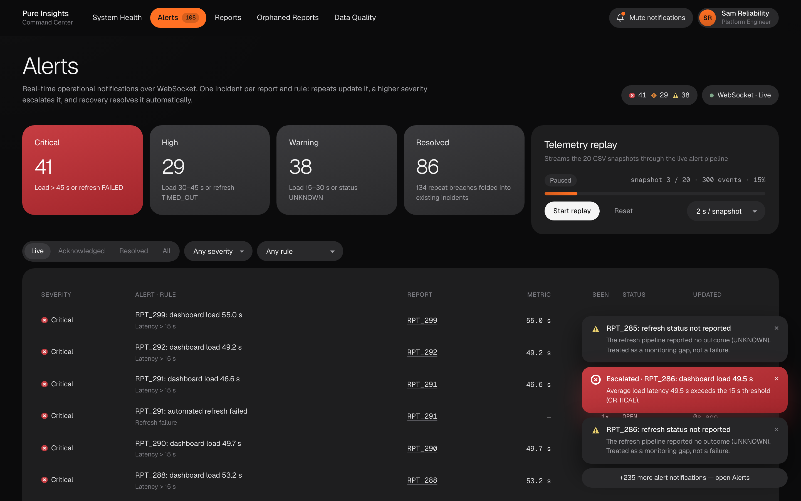

Mid-replay, as the Platform Engineer.

* **Toasts:** WebSocket messages arrive as toasts. An "Escalated · …" toast is an existing incident moving up a severity band, not a new alert. Bursts are capped at 3 toasts plus a "+N more" summary.
* **One incident per report and rule:** the capture uses the replay's `pauseAfterSnapshot: 3` setting, so the replayer stops itself at exactly 300 events and these numbers reproduce. At that point there are **108 live incidents** (41 critical, 29 high, 38 warning) and **86 auto-resolved** ones, and **134 repeat breaches** were folded into existing incidents instead of producing new notifications.

### 4 · Alert lifecycle

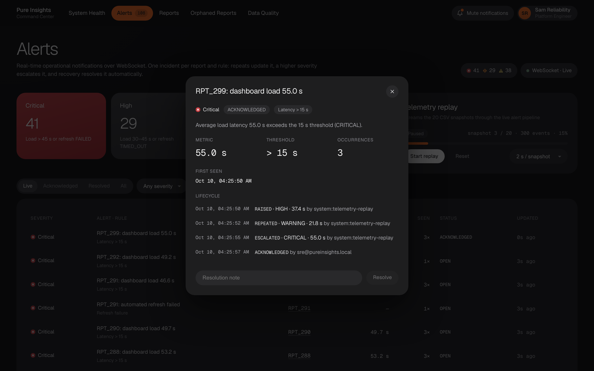

One incident's full history, for RPT_299:

1. **RAISED** at HIGH (37.4 s).
2. **REPEATED** at WARNING (21.8 s).
3. **ESCALATED** to CRITICAL at **55.0 s**, the dataset's most extreme load. The value is alerted on as-is, never capped.
4. **ACKNOWLEDGED** by the engineer.

Every transition, with its actor, is stored in `app.alert_events`. When latency returns to ≤ 15 s (or a refresh
succeeds) the incident resolves automatically.

### 5 · Orphaned reports (Task 1)

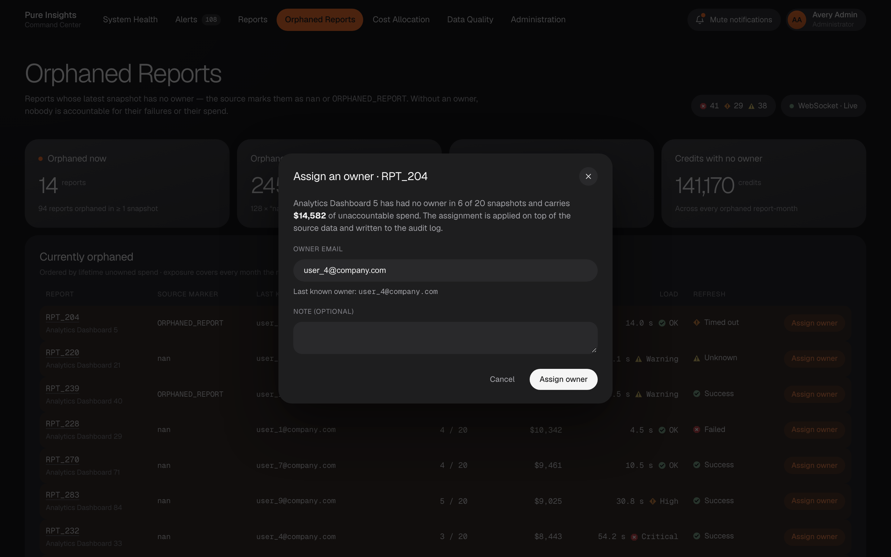

The 14 reports with no owner in their latest snapshot. Each row shows the raw source marker (`nan` /
`ORPHANED_REPORT`), the last known owner, and the lifetime spend accumulated while it had no owner. In total,
orphaned report-months carry **$480.9K** across 245 rows. The admin-only dialog assigns an owner. The change is
an audited override, so the source data is never edited, and it is pushed live to the new owner's session.

### 6 · Report drill-down

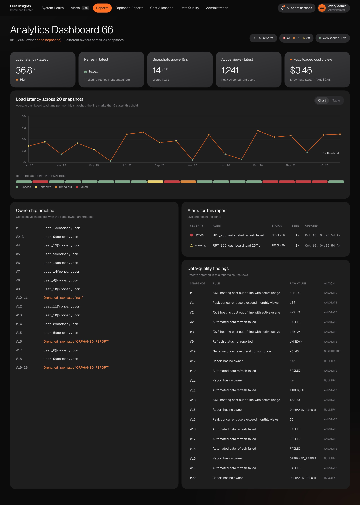

RPT_265 ties several anomalies together:

* **Latency:** 14 of 20 snapshots above 15 s, each point coloured by its severity band.
* **Refresh outcomes:** 7 failed refreshes in the outcome strip.
* **Ownership:** 9 different owners, with orphan spans showing the raw values.
* **Data quality:** a −8.43 credit reading quarantined in snapshot 10.
* **Cost:** fully loaded cost of **$3.45 per active view** (FinOps/Admin only).

### 7 · Cost allocation (Task 3)

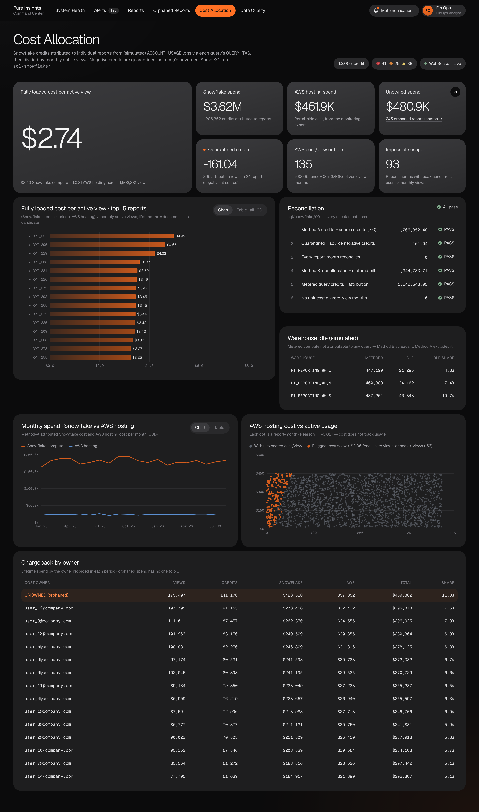

Snowflake credits attributed per report from `QUERY_ATTRIBUTION_HISTORY` via `QUERY_TAG`, using the same SQL as
[`sql/snowflake/`](sql/snowflake/README.md).

* **Unit cost:** at $3/credit, a view costs **$2.74 fully loaded** ($2.43 Snowflake + $0.31 AWS).
* **Reconciliation:** all six checks **PASS**. Method A equals the clean source credits to the cent, and the quarantined amount equals the −161.04 of negatives.
* **Ranking:** the top 15 reports by cost per view; ★ marks decommission candidates.
* **AWS scatter:** shows hosting cost does not follow usage, with flagged report-months in copper.
* **Chargeback:** spend by owner, with orphaned spend (11.8 %) as the largest "owner".

### 8 · Data quality

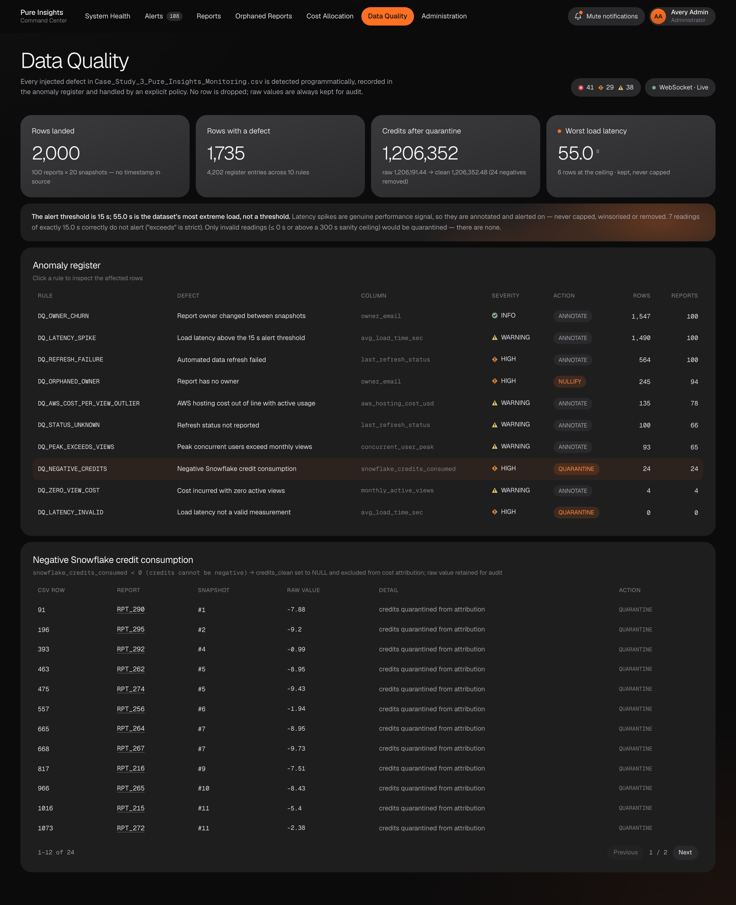

The anomaly register: 10 rules, each with its detection logic, severity, action (NULLIFY / QUARANTINE /
ANNOTATE) and the number of rows and reports affected. Selecting a rule lists the offending CSV rows with their
raw values. The callout spells out the 15 s threshold vs 55 s extreme distinction. The same register drives the
generated [docs/DATA_QUALITY.md](docs/DATA_QUALITY.md).

### 9 · RBAC in action

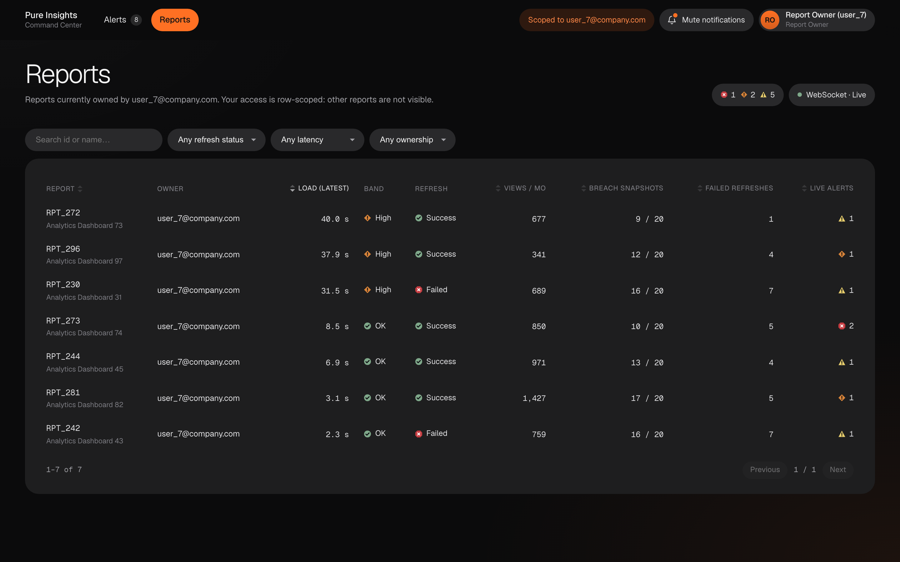

Signed in as the Report Owner `user_7@company.com`:

* **Navigation:** only Alerts and Reports.
* **Data:** the table holds exactly the **7 reports** user_7 currently owns, and the top bar shows the scope.
* **Real-time:** alerts and WebSocket messages are filtered to those reports on the server.

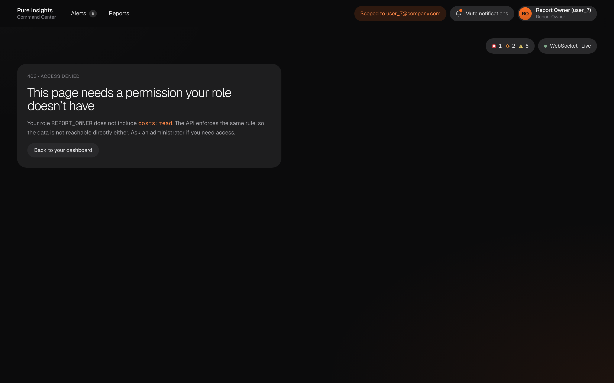

Opening `/costs` directly shows a 403 page that names the missing permission (`costs:read`). The API rejects the
same request with a 403 and records the denial in the audit log.

### 10 · Administration

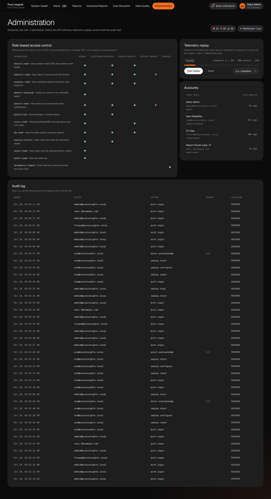

* **Permission matrix:** the role → permission matrix that the API enforces (◐ = row-scoped).
* **Replay controls:** start, pause, reset and speed.
* **Accounts.**
* **Audit trail:** sign-ins, the alert acknowledgement and the replay actions from the session above.

---

## Key findings (summary)

The full write-up, generated from live queries, is in [docs/BUSINESS_FINDINGS.md](docs/BUSINESS_FINDINGS.md).

1. **The latency SLO is broken across the whole platform.** 74.5 % of report-months exceed 15 s, with a median of 27.8 s. Fixing a handful of slow dashboards will not help, so the fix belongs in shared layers: warehouse sizing, caching, payload size.
2. **28.2 % of refreshes fail or time out.** Latency is the same whether a refresh failed or succeeded, so the two problems have independent causes.
3. **Unowned spend is $480.9K**, the largest "owner" in the chargeback. Mandatory ownership at publish time would close it.
4. **AWS hosting cost is decoupled from usage** (r = −0.027). This points to rightsizing; there are 10 decommission candidates.
5. **Snowflake dominates unit cost.** At $3/credit it is $2.43 of the $2.74 per view.

## Assumptions

* The 20 identical passes over the 100 reports are monthly snapshots. The CSV has no timestamp.
* `CREDIT_PRICE_USD = 3.00`. This is not in the data and is configurable.
* The Snowflake `ACCOUNT_USAGE` logs are **simulated** from the CSV, deterministically, and reconcile to it exactly. Figures that exist only in the simulation are labelled. These are warehouse idle time, untagged ad-hoc spend, and failed-query spend.
* The 30 s and 45 s severity tiers are configurable display bands. Only the 15 s threshold comes from the brief.
* The SQL suite is portable and has been verified on PostgreSQL. The Snowflake bootstrap script is provided but was not executed, because no Snowflake account was available.

## Repository layout

```
├─ data/raw/                 source CSV (data/simulated/ is generated)
├─ db/migrations/            idempotent PostgreSQL DDL
├─ pipeline/                 Python: ingest · quality rules · simulation · SQL-suite runner · docs generators · screenshots
├─ sql/snowflake/            Deliverable 3 — cost allocation SQL suite (00–09)
├─ server/                   Node.js/Express API, RBAC, alerting, WebSocket hub, replay (+ tests)
├─ client/                   React dashboard (+ tests)
└─ docs/                     API spec (MD + OpenAPI + AsyncAPI), architecture, RBAC, methodology,
                             generated data-quality and findings reports, screenshots
```
