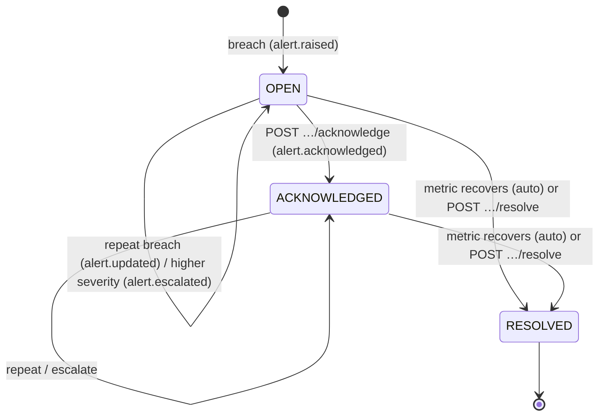
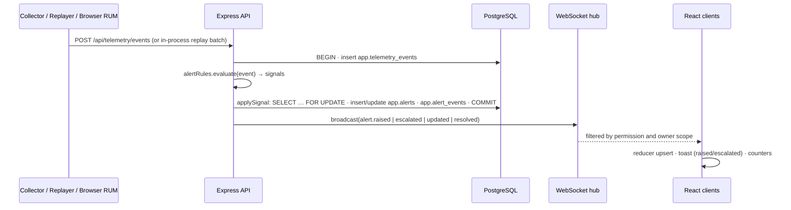

# REST API & WebSocket Technical Specification

**Pure Insights Command Center** · API version 1.0.0

This document specifies the HTTP API (Node.js/Express) and the real-time WebSocket channel that power the
Command Center dashboard. Machine-readable versions:

* [`openapi.yaml`](openapi.yaml): OpenAPI 3.1, covering every REST operation. A contract test (`server/test/openapi.contract.test.js`) fails the build if a mounted Express route is missing from it or if the spec documents a route that does not exist.
* [`asyncapi.yaml`](asyncapi.yaml): AsyncAPI 3.0, covering every WebSocket message.

---

## 1. Conventions

| Item | Convention |
|---|---|
| Base URL | `http://localhost:4000` (in development the Vite server on `:5173` proxies `/api` and `/ws`) |
| Format | JSON request and response bodies, UTF-8 |
| Naming | Query/body parameters are `camelCase`; response rows mirror database columns (`snake_case`) |
| Time | ISO-8601 UTC timestamps; report periods are `YYYY-MM-DD` dates (first of month) |
| Validation | Every input is validated with zod. Failures return `400 BAD_REQUEST` with per-field `details` |
| SQL | Parameterised queries only; sort columns are chosen from a whitelist |

### Error model

Every error has the same envelope:

```json
{ "error": { "code": "FORBIDDEN", "message": "Missing permission: costs:read", "details": null } }
```

| Status | `code` | When |
|---|---|---|
| 400 | `BAD_REQUEST`, `BAD_JSON` | Validation failure or malformed JSON |
| 401 | `UNAUTHENTICATED`, `INVALID_CREDENTIALS`, `INVALID_API_KEY` | No valid session, wrong password, wrong collector key |
| 403 | `FORBIDDEN`, `CSRF_CHECK_FAILED` | Role lacks the permission, or a browser request is missing the CSRF header |
| 404 | `NOT_FOUND` | Unknown resource, **or** a report outside an owner-scoped user's scope (so existence is not leaked) |
| 409 | `INVALID_STATE` | Illegal alert transition (for example, acknowledging an already acknowledged alert) |
| 429 | `TOO_MANY_ATTEMPTS`, `RATE_LIMITED` | Login brute-force limit or RUM beacon limit |
| 500 | `INTERNAL` | Unexpected error (logged with the request id; no internals leaked) |

### Pagination

List endpoints that can grow take `page` (1-based) and `pageSize`, and return `{ page, pageSize, total, <items> }`.

---

## 2. Authentication & sessions

**Login method:** local accounts in PostgreSQL (`app.users`), passwords hashed with **bcrypt (cost 12)**.
No third-party identity provider is used. An OIDC provider (Okta / Azure AD) could replace the login step
behind the same session middleware.

```
POST /api/auth/login        { "email": "sre@pureinsights.local", "password": "…" }
→ 200 { "user": { email, displayName, role, ownerEmail, ownerScoped, permissions[] } }
  Set-Cookie: pic_session=<JWT>; Path=/; HttpOnly; SameSite=Strict; Max-Age=28800  (+ Secure in production)
```

* The session is a **JWT (HS256, 8 h, issuer `pure-insights-command-center`)** stored in an **httpOnly** cookie.
  The token is never returned in a body or exposed to JavaScript.
* The user row is re-read on every request, so deactivating an account or changing its role takes effect immediately.
* **CSRF:** the cookie is `SameSite=Strict`. In addition, every browser request must send
  `X-Requested-With: XMLHttpRequest`. A cross-site page cannot add that header without a CORS preflight, and the
  CORS allowlist rejects that preflight.
* **Brute force:** failed logins are limited to `LOGIN_RATE_LIMIT` (default 10) per IP per 15 minutes. Unknown
  e-mails still run a bcrypt compare, so response timing does not reveal which accounts exist. Failures are audited.
* `GET /api/auth/me` returns the current user. `POST /api/auth/logout` clears the cookie.
* **Telemetry collectors** (machine-to-machine) send `X-API-Key: <TELEMETRY_API_KEY>`, which is compared in
  constant time. They get the **SERVICE** role, whose only permission is `telemetry:ingest`.

### Demo accounts

| Account | Role |
|---|---|
| `admin@pureinsights.local` | ADMIN |
| `sre@pureinsights.local` | PLATFORM_ENGINEER |
| `finops@pureinsights.local` | FINOPS_ANALYST |
| `user_7@company.com` | REPORT_OWNER (row-scoped to the reports user_7 currently owns) |

All demo accounts use the password from `SEED_DEMO_PASSWORD` in `.env`.

---

## 3. Role-based access control

The matrix lives in `server/src/auth/permissions.js`. It is enforced on every REST route and filters every
WebSocket message. The React app mirrors it for navigation only. Every denial is written to `app.audit_log`.

| Permission | ADMIN | PLATFORM_ENGINEER | FINOPS_ANALYST | REPORT_OWNER | SERVICE |
|---|:-:|:-:|:-:|:-:|:-:|
| `health:read`: system health and platform self-health | ● | ● | ● | | |
| `reports:read`: report inventory and drill-down | ● | ● | ● | ◐ | |
| `orphans:read`: orphaned reports and exposure | ● | ● | ● | | |
| `owners:reassign`: assign an owner | ● | | | | |
| `alerts:read`: alerts and real-time notifications | ● | ● | ● | ◐ | |
| `alerts:ack`: acknowledge / resolve | ● | ● | | | |
| `costs:read`: Snowflake/AWS cost allocation | ● | | ● | | |
| `dq:read`: data-quality register | ● | ● | ● | | |
| `replay:control`: start/stop/reset replay | ● | ● | | | |
| `users:read`: accounts and RBAC matrix | ● | | | | |
| `audit:read`: audit log | ● | | | | |
| `telemetry:ingest`: push telemetry | | | | | ● |

◐ means **row-scoped**: a REPORT_OWNER sees only reports whose *current* owner (latest snapshot, or an admin
override) equals their `owner_email`. This applies to the alerts of those reports too. Out-of-scope reports
return 404.

---

## 4. REST endpoints

| Method | Path | Permission | Purpose |
|---|---|---|---|
| POST | `/api/auth/login` | public | Sign in (sets cookie) |
| POST | `/api/auth/logout` | public | Clear session |
| GET | `/api/auth/me` | authenticated | Current user and permissions |
| GET | `/api/health` | public | Liveness probe (DB round-trip) |
| GET | `/api/health/system` | `health:read` | DB latency, WebSocket clients, replay, telemetry rate, API p50/p95/p99 |
| GET | `/api/dashboard/summary` | `health:read` | Latest-snapshot and all-time KPIs, live alerts by severity |
| GET | `/api/dashboard/latency-distribution?scope=all\|latest` | `health:read` | 5 s histogram with severity band per bin |
| GET | `/api/dashboard/trend` | `health:read` | Per-snapshot breach rate, failure rate, p50/p95 |
| GET | `/api/dashboard/slowest?limit=` | `health:read` | Slowest reports in the latest snapshot |
| GET | `/api/reports` | `reports:read` ◐ | Filter/sort/paginate the inventory |
| GET | `/api/reports/{reportId}` | `reports:read` ◐ | 20-snapshot history, owner timeline, alerts, DQ issues, cost |
| GET | `/api/orphans` | `orphans:read` | Current orphans with unowned spend, summary, reassignments |
| GET | `/api/orphans/owners` | `owners:reassign` | Owner picker list |
| POST | `/api/orphans/{reportId}/assign-owner` | `owners:reassign` | Admin owner override (audited, broadcast) |
| GET | `/api/alerts` | `alerts:read` ◐ | List / resync (`status`, `severity`, `rule`, `reportId`, `since`, `limit`) |
| GET | `/api/alerts/stats` | `alerts:read` ◐ | Counts and last-hour lifecycle events |
| GET | `/api/alerts/{alertId}` | `alerts:read` ◐ | Alert and full lifecycle |
| POST | `/api/alerts/{alertId}/acknowledge` | `alerts:ack` | OPEN → ACKNOWLEDGED |
| POST | `/api/alerts/{alertId}/resolve` | `alerts:ack` | Manual resolve with a note |
| POST | `/api/telemetry/events` | `telemetry:ingest` (API key) | Ingest collector events |
| POST | `/api/telemetry/rum` | authenticated | Browser page-load beacon |
| GET | `/api/telemetry/recent` | `health:read` | Latest telemetry events |
| GET | `/api/telemetry/replay` | `health:read` | Replay status |
| POST | `/api/telemetry/replay/start` \| `stop` \| `reset` \| `config` | `replay:control` | Replay control (`config` takes `intervalMs`, `loop`, `pauseAfterSnapshot`) |
| GET | `/api/costs/summary` | `costs:read` | Portfolio unit cost, reconciliation, quarantine, metering, discrepancy, unit cost by edition price |
| GET | `/api/costs/reports` | `costs:read` | Per-report unit cost, ranking, decommission flag, Method A vs B |
| GET | `/api/costs/reports/{reportId}` | `costs:read` | Monthly unit cost and Method B allocation |
| GET | `/api/costs/trend` | `costs:read` | Monthly Snowflake and AWS spend |
| GET | `/api/costs/chargeback` | `costs:read` | Spend by owner (orphaned spend explicit) |
| GET | `/api/costs/discrepancy` | `costs:read` | AWS cost vs views, with the 3×IQR fence and flags |
| GET | `/api/data-quality/summary` | `dq:read` | Totals, credits before/after quarantine, latency extremes |
| GET | `/api/data-quality/rules` | `dq:read` | Rule catalog with counts |
| GET | `/api/data-quality/forensics` | `dq:read` | Statistical checks behind the structural findings |
| GET | `/api/data-quality/issues` | `dq:read` | Anomaly register rows |
| GET | `/api/admin/users` | `users:read` | Accounts |
| GET | `/api/admin/rbac` | `users:read` | Role → permission matrix |
| GET | `/api/admin/audit` | `audit:read` | Audit trail |

### Example: ingest telemetry and get alert transitions back

```http
POST /api/telemetry/events
X-API-Key: pic-dev-telemetry-key
Content-Type: application/json

{ "events": [ { "type": "report.telemetry", "reportId": "RPT_200",
                "avgLoadTimeSec": 52.3, "refreshStatus": "TIMED_OUT" } ] }
```

```http
202 Accepted
{ "accepted": 1,
  "transitions": [
    { "type": "alert.raised", "alertId": 41, "ruleCode": "LATENCY_SLO_BREACH", "reportId": "RPT_200", "severity": "CRITICAL" },
    { "type": "alert.raised", "alertId": 42, "ruleCode": "REFRESH_FAILURE",    "reportId": "RPT_200", "severity": "HIGH" } ] }
```

Event schema: `type` = `report.telemetry`, `reportId` (`^[A-Za-z0-9_-]{1,40}$`), and at least one of
`avgLoadTimeSec` (number) or `refreshStatus` (string). Optional fields: `snapshotSeq` and `observedAt`. A request
carries 1–500 events.

### Example: owner reassignment

```http
POST /api/orphans/RPT_204/assign-owner
X-Requested-With: XMLHttpRequest
{ "ownerEmail": "user_4@company.com", "note": "Last known owner, confirmed by BI lead" }
→ 200 { "report": { "report_id": "RPT_204", "owner_email": "user_4@company.com", "is_orphaned": false, "has_owner_override": true, … } }
```

The source data is never modified. The override sits in `app.owner_overrides`, is applied through the
`app.v_report_current` view, is written to the audit log, refreshes the WebSocket owner scopes, and is
broadcast as `report.owner_changed`.

---

## 5. Alerting rules (Task 2)

| Rule | Fires when | Severity | Clears when |
|---|---|---|---|
| `LATENCY_SLO_BREACH` | `avg_load_time_sec` **strictly greater than 15 s** | WARNING ≤ 30 s < HIGH ≤ 45 s < CRITICAL | latency ≤ 15 s |
| `REFRESH_FAILURE` | refresh status `FAILED` / `TIMED_OUT` | CRITICAL / HIGH | status `SUCCESS` |
| `TELEMETRY_GAP` | refresh status `UNKNOWN` (or unrecognised) | WARNING | any known status |
| `RUM_SLOW_LOAD` | a Command Center page took > 15 s to load | by latency band | next load ≤ 15 s |

* **15 s is the only threshold taken from the brief.** The 30 s and 45 s tiers are configurable display bands
  (`LATENCY_HIGH_ABOVE_SEC`, `LATENCY_CRITICAL_ABOVE_SEC`).
* **55 s is not a threshold.** It is the largest load latency in the dataset (6 readings sit exactly at 55.0 s).
  Spikes are never capped. A 55 s reading raises a CRITICAL alert with `metric_value = 55`.
* Readings that are not valid measurements (non-finite, ≤ 0 s, or > `LATENCY_INVALID_ABOVE_SEC` = 300 s) are stored
  but never alert. They count as bad data, not bad performance.
* A reading of exactly 15.0 s does **not** alert, because the brief says "exceeds".

### Incident lifecycle and de-duplication



* At most **one live incident per `dedupe_key`** (`<rule>:<reportId>`, or `RUM_SLOW_LOAD:<route>`). A partial
  unique index on `app.alerts (dedupe_key) WHERE status <> 'RESOLVED'` enforces this.
* `severity` is the current severity and `peak_severity` is the worst seen. `occurrence_count` counts breaches
  folded into the incident.
* Every transition is stored in `app.alert_events` (RAISED / REPEATED / ESCALATED / ACKNOWLEDGED / RESOLVED) with
  the actor.
* Events are processed sequentially by an in-process queue, so concurrent ingests cannot race the de-duplication.
* Why this matters: 74.5 % of the dataset's report-months exceed 15 s. Without de-duplication the stream would emit
  about 1,490 notifications instead of tens of incidents.

### Data flow



---

## 6. WebSocket channel

### Handshake

```
GET /ws HTTP/1.1
Upgrade: websocket
Cookie: pic_session=<JWT>
Origin: http://localhost:5173
```

| Outcome | Response |
|---|---|
| Valid session and `alerts:read` | `101 Switching Protocols`, then a `session.ready` message |
| Missing or invalid cookie | `401 Unauthorized` (upgrade refused) |
| Origin not allowed, or role lacks `alerts:read` | `403 Forbidden` |
| Path other than `/ws` | `404 Not Found` |

The same cookie authenticates REST and WebSocket, so no token ever appears in a URL or in JavaScript.

### Envelope

```json
{ "type": "alert.escalated", "id": "2f0c3b7e-…", "ts": "2026-10-10T03:38:39.120Z", "data": { … } }
```

`id` is unique per message. Clients use it to de-duplicate toasts.

### Messages (server → client)

| `type` | Payload | Delivered to |
|---|---|---|
| `session.ready` | `{ email, role, scopedReports }` | the connecting client |
| `alert.raised` | Alert | `alerts:read`; owner-scoped by `report_id` |
| `alert.escalated` | Alert (higher severity) | same |
| `alert.updated` | Alert (repeat breach; count/metric changed) | same |
| `alert.acknowledged` | Alert | same |
| `alert.resolved` | Alert (auto-recovery or manual) | same |
| `alerts.cleared` | `{ reason }` | `alerts:read` (replay reset) |
| `report.owner_changed` | Report (current view row) | `reports:read`; owner-scoped |
| `telemetry.snapshot` | `{ snapshotSeq, reports, latencyBreaches, refreshFailures, medianLatencySec }` | `health:read` |
| `replay.status` | ReplayStatus | `health:read` |
| `system.heartbeat` | `{ clients }` | everyone, every 30 s |

Inbound client messages are ignored (`maxPayload` 16 KiB).

### Liveness, reconnect and resync

1. The server sends a protocol ping every 30 s. A socket that misses a pong is terminated.
2. On close, the client reconnects with **exponential backoff and jitter**: delay = random(½, 1) × min(30 s, 1 s × 2^attempt).
3. On every successful (re)connect the client **resyncs over REST**. The first connect calls
   `GET /api/alerts?status=live`. Later connects call `GET /api/alerts?status=all&since=<serverTime of last sync>`
   and merge the result. The reducer keeps whichever copy has the newer `updated_at`, so out-of-order events
   cannot roll state back.
4. The UI shows the connection state (Live / Connecting / Reconnecting / Offline). At most 3 toasts are shown at a
   time; any burst beyond that becomes a single "+N more" item.

---

## 7. Operational limits

| Limit | Value |
|---|---|
| Login failures | `LOGIN_RATE_LIMIT` per IP per 15 min (default 10) |
| RUM beacons | 60 per minute per IP |
| Telemetry batch | 1–500 events per request |
| JSON body | 256 KiB |
| WebSocket inbound frame | 16 KiB |
| Session lifetime | `SESSION_TTL_HOURS` (default 8) |
