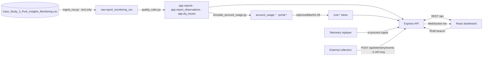

# Architecture — Pure Insights Command Center

## Stack

**CSV → PostgreSQL → Node.js/Express → React**, as mandated. There is no other database or application framework.

| Layer | Technology | Responsibility |
|---|---|---|
| Data pipeline | Python 3 (pandas, numpy, psycopg 3) | Land the CSV verbatim, detect and clean anomalies, build the cleaned model, simulate Snowflake `ACCOUNT_USAGE`, run and verify the SQL suite, generate the data-quality and findings docs |
| Database | PostgreSQL 16 (Docker Compose) | Single application database: raw, cleaned, application state, simulated logs, cost views |
| API | Node.js + Express 5 (JavaScript, ESM) | REST API, RBAC, sessions, telemetry ingestion, alert lifecycle, WebSocket hub, replay |
| Real-time | `ws` WebSocket server on the same HTTP server | Cookie-authenticated, permission- and owner-filtered push |
| UI | React 19 + Vite, React Router, Recharts | Dark-only operations console |

## Database schemas

| Schema | Contents |
|---|---|
| `raw` | `report_monitoring_csv`: every value as text, with `source_row_number` lineage |
| `app` | `reports` (100), `report_observations` (2,000), `dq_rules`, `dq_issues`, `users`, `owner_overrides`, `v_report_current`, `audit_log`, `telemetry_events`, `alerts`, `alert_events` |
| `portal` | `report_usage_monthly` (view over observations), `credit_pricing` |
| `account_usage` | Simulated `query_history`, `query_attribution_history`, `warehouse_metering_history` |
| `cost` | Views created by the Snowflake SQL suite (dropped and rebuilt on each run) |

Migrations are idempotent SQL files in `db/migrations/`, applied by `pic_pipeline.migrate` and tracked with
checksums in `public.schema_migrations`.

### The data model behind the CSV

The CSV has no timestamp. The 2,000 rows are 20 complete, identically ordered passes over 100 report ids, which
was verified for every row. The pipeline models them as a report **dimension** (100) and an **observation fact**
(report × snapshot, 2,000). Snapshot *k* maps to month 2025-01 + (k − 1).

* **Current state** of a report = its latest snapshot.
* **Current owner** = owner in the latest snapshot, or an admin override (`app.owner_overrides`, applied by `app.v_report_current`).
* **Nothing is deleted.** Defects are nulled or quarantined in typed columns, flagged with booleans, and recorded once per (row, rule) in `app.dq_issues`. The raw text always stays in `raw`.

## Request path and security

1. `helmet` (CSP, no `x-powered-by`), CORS allowlist with credentials, 256 KiB JSON limit, cookie parser, `pino-http` logging, API latency metrics.
2. CSRF guard: non-GET browser requests require `X-Requested-With: XMLHttpRequest`. Requests carrying `X-API-Key` are exempt.
3. Per-mount guard: `authenticate` (session cookie → user re-read from the DB), then `requirePermission(<perm>)`. Routes that need a narrower permission add a second guard (for example, `alerts:ack` under `alerts:read`).
4. Handlers validate input with zod and apply `ownerScope` for REPORT_OWNER. Owner-scoped misses return 404.
5. A central error handler maps `HttpError` to the documented error envelope. Unknown errors are logged and returned as a generic 500.

## Real-time design (Task 2)

* **One ingest path** for the three sources (replay, collectors, browser RUM): persist the telemetry event, evaluate the pure rules (`alertRules.js`), apply the alert lifecycle in the same transaction (`alertService.js`), commit, then broadcast.
* **Sequential processing** through an in-process promise queue, plus a partial unique index, guarantees one live incident per rule and report.
* **Replay** turns the static dataset into a live feed. It streams the 2,000 observations in snapshot order, 10 batches per snapshot, at a configurable interval. A `telemetry.snapshot` summary is sent after each snapshot.
* **Back-pressure in the UI:** at most 3 toasts on screen, overflow summarised, and a mute toggle. Repeat breaches arrive as silent `alert.updated` messages.
* **Resilience:** heartbeat ping/terminate, client reconnect with jittered exponential backoff, and REST resync with `since`.

## Cost allocation (Task 3)

See [COST_ALLOCATION_METHODOLOGY.md](COST_ALLOCATION_METHODOLOGY.md). The SQL suite in `sql/snowflake/` builds the
`cost.*` views that `/api/costs/*` reads. Its six reconciliation checks run in `npm run verify` and in pytest.

## Frontend

* `AuthProvider` loads `/api/auth/me`, and `RequirePermission` gates routes. Navigation is derived from the same permission names as the API (`auth/navigation.js`).
* `AlertStreamProvider` owns the socket, the alert reducer (`alertsReducer.js`, pure and tested), toasts, replay state and an event bus that pages subscribe to (`useStreamEvent`).
* `useApi` keeps the previous data while refetching (rendered at reduced opacity) to avoid layout flashes.
* `rum.js` measures how long each page takes to become usable and posts it to `/api/telemetry/rum`, so the Command Center monitors its own dashboard load latency.
* **Theme:** dark-only, with design tokens in `theme/tokens.css`. The layout is inspired by a two-tone analytics dashboard concept: top pill navigation, large light-weight titles and numbers, rounded charcoal cards for tables and charts, lighter glass cards for KPIs, pill filter groups, gradient bars with a solid cap (`components/chartShapes.jsx`) and a glow callout. Colour elements (neutral text scale, copper accent) come from the agent-auto-optimizer design system. The severity palette (sage, amber, copper, red `#c63d42`) was validated for colour-vision-deficiency separation, normal-vision separation and ≥ 3:1 contrast on the card surface. Severity always comes with an icon and a text label, and every chart has a table view.

## Testing

| Suite | Runner | Covers |
|---|---|---|
| `pipeline/tests` | pytest | every anomaly count; threshold edges (15.0 / 15.01 / 55.0 / invalid); owner normalisation; fail-fast on bad numerics; simulation reconciles per report-month; determinism; SQL portability guard; full pipeline into the test DB; all reconciliation checks |
| `server/test` | `node:test` + fetch + `ws` | rule edges; RBAC matrix; 401/403/404 scoping; CSRF; cookie flags; login rate limit; owner reassignment; raise → escalate → de-duplicate → auto-resolve over a real WebSocket; owner-scoped delivery; ack/resolve workflow; API-key ingest; RUM; replay of snapshot 1 (77 alerts); OpenAPI contract |
| `client/src/test` | Vitest + Testing Library | permission-gated navigation; 403 route for a report owner; login redirect; alert reducer (ordering, stale events, resync merge); backoff; severity never colour-only |
